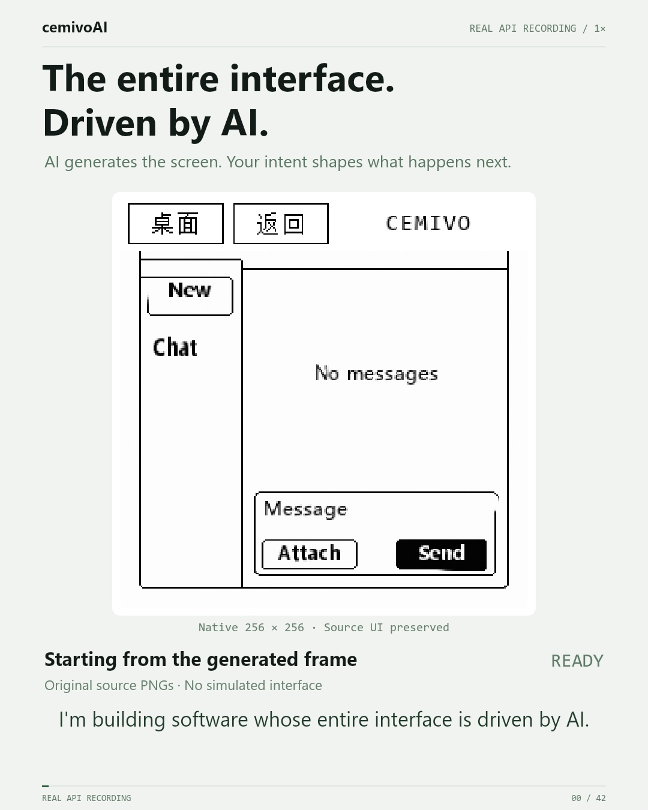
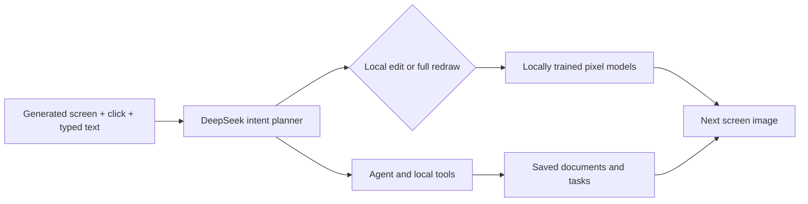

# cemivoAI

### Software with an entirely AI-driven interface

cemivoAI explores a screen that is generated as an image and changes with your intent. Click the picture or type an instruction: a planner considers the full frame and the interaction, then chooses what the visual model should redraw. An Agent connects the interface to actual local work.



**[Watch the 42-second English demonstration](film/renders/cemivoAI-X-EN.mp4)** · [Setup and training](docs/SETUP.md) · [Film source](film) · [Launch copy and profile bio](docs/LAUNCH.md) · [License](LICENSE)

This is an experimental research prototype. General UI quality, prompt following, readable text and reliable interaction across arbitrary applications are still being improved. The ambition is one adaptive interface for many kinds of work; that broader capability has not been achieved.

## How it works



The main visual model is a **109,399,041-parameter text-conditioned pixel-space Rectified Flow network**, trained from random weights. It combines a byte-level text Transformer with a conditional UNet. Auxiliary neural heads handle bounded text, toggle and navigation-surface changes. Their code is included. Training renderers create supervision; the neural inference path does not call them to draw the output.

**DeepSeek is an external, separately trained service** used for intent planning. “From random weights” describes this project's local visual models, not DeepSeek. The AI-driven interface is the image inside the application; the hosting web shell, recorder labels, film diagrams and subtitles are ordinary application or animation code.

Confirmed same-page interactions can reuse a validated local rule and neural edit path. Uncertain actions return to planning and verification. Agent completion is tracked through actual tool receipts, separately from whether the picture redraw succeeds. Current tools work with local documents, notes, tasks and text exports.

## What is in this repository

| Area | Contents |
| --- | --- |
| Root Python modules | Local HTTP service, interaction planning, edit verification and Agent runtime |
| `neural/` | Model architectures, synthetic-data generation, training, sampling and checkpoint utilities |
| `scripts/` | Separate research training recipes for the text, toggle and surface heads |
| `web/` | Training console, image workbench and image-based interaction shell |
| `film/` | JavaScript Canvas composition, original procedural score, retained narration, real recording evidence and final MP4 |
| `docs/SETUP.md` | Environment setup, training and model-file requirements |

**Trained weights and training datasets are not in Git history.** A fresh clone can run the local console and render the supplied film, but reproducing neural APP behavior requires trained main and auxiliary checkpoints. [Setup](docs/SETUP.md) documents the main-model training path, auxiliary recipes and additional artifacts needed by the interaction demo. Installing dependencies alone does not recreate the film's trained model.

## Quick start

### Minimal Windows app

After installing dependencies and configuring trained model files, run `build-app.ps1` to build `cemivoAI.exe`. Keep the executable in the project folder and double-click it. It opens a 540×580 app window: configure the DeepSeek API first, then enter the generated screen. Existing process-memory credentials can be reused; no API key is saved to disk or browser storage. Saving a key does not verify the provider connection; actual planning reports provider errors. Left-click operates the image; right-click offers text entry and Send. API configuration returns when the service loses its credentials.

The EXE is a small Windows launcher for the local Python service and Edge app window, not a standalone bundle of Python or trained weights. `cemivoAI.cmd` provides the same entry without compilation. Build source is included in `CemivoLauncher.cs`.

Python 3.12 and an NVIDIA CUDA-capable environment were used for development. From the repository root on Windows PowerShell:

```powershell
py -3.12 -m venv .venv
.\.venv\Scripts\python.exe -m pip install -r requirements.txt
.\.venv\Scripts\python.exe server.py --port 7861
```

Open **http://127.0.0.1:7861/train** for the training console or **http://127.0.0.1:7861/live** for interaction settings. The service binds to localhost. Missing models are reported as unavailable; configure trained weights before expecting image generation. DeepSeek planning also needs your own API key, entered in the local UI. See [setup](docs/SETUP.md) for dataset generation, checkpoint preparation, CPU/Linux considerations and exact model paths.

To re-render the film independently of the APP:

```sh
cd film
npm install
node render.cjs
```

This uses the retained real model PNGs and narration; it makes no APP requests and performs no Agent actions. FFmpeg must be on `PATH`. The renderer currently registers Windows fonts; adjust those paths on another operating system. The delivered MP4 needs no development dependencies to watch.

## What the demonstration establishes

The film uses original 256×256 model PNGs and recorded localhost requests, played at normal speed. It is an API-driven recording, rather than desktop screen capture. Hashes and the six recorded input/send results are retained in [`film/trace.json`](film/trace.json).

- All six recorded operations completed; identical request replays matched, existing messages were preserved, and independently measured changes outside the approved edit regions were **0 pixels**.
- The four confirmed same-page short-text operations measured **37.00–45.40 ms** end to end. The first input and send took **3.62 and 4.55 seconds**. These measurements describe this recording, not arbitrary requests or a universal latency guarantee.
- The Agent actually saved `CEMIVO Film Demo`, with the content `One screen. One intent.`, and the content was read back from local storage to verify it.

The opening keeps the APP's original pixels, including its Chinese navigation labels. Principle diagrams and mask annotations are labeled separately. The demo is evidence for the recorded short chat sequence and document save, not acceptance of every page or application. [Film audit](film/audit.json) contains the bounded checks.

## Development and privacy

Do not commit API keys, local Agent databases, training state or private screenshots. The normal UI configuration stores the DeepSeek key in process memory; the optional `DEEPSEEK_API_KEY` environment variable also supplies it. Restarting a process clears a key entered only through the UI. A planning request sends the screen and interaction context to the configured external provider, so use appropriate demo content.

See [Contributing](CONTRIBUTING.md) for useful changes and validation expectations. Original source is provided under the [MIT License](LICENSE); dependencies, font software and external services retain their own terms. [Third-party notices](THIRD_PARTY_NOTICES.md) explain the film's generic synthesized narration and font dependencies.
