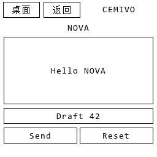
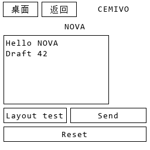
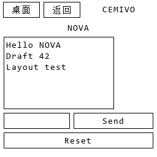

# Keep content while the AI redesigns an interface

`2.16.0-stateful-ui` fixes two observed interaction failures and adds exact content transfer between AI-generated layouts.

Right-click the current app image and describe the revision, for example:

> Redesign this same NOVA chat. Keep the exact title NOVA and buttons Send and Reset. Make the message panel narrower. Make the input shorter and place Send to the right of the input on the same row. Put Reset on its own row. Preserve all my sent messages and current draft exactly. Do not send or clear anything.

The AI selects `navigation: {action: "open_app", target_app: "NOVA", redraw: true, preserve_state: true}` from the actual complete screenshot, click, text and committed UI state. A populated app cannot silently redraw without an explicit retention decision; a missing decision triggers bounded read-only correction or retains the old page. Ordinary Home/Back/open-app navigation still uses the existing page cache. A new empty-app request can explicitly use `preserve_state: false`.

## Content transfer

The layout planner sees the previous complete PNG, original application context and indexed retained input/panel fields. It chooses the new controls and their geometry, then supplies `state_bindings` from old element indices to new indices. Every retained field must map exactly once to the same control kind. The host injects exact committed values before glyph-fit, spacing and screen validation; it does not use an AI transcription of user content.

The locally trained SurfaceHead/TextHead decoders generate the new image. Message and draft tracking bounds are rebuilt from the same native text-placement function used by rendering. Later Send, input and draft-only Reset can therefore use the moved fields. Full-image structural review gates publication. Failed binding, missing glyphs or insufficient space retain the old committed frame. Private credential and local-computer pages are excluded from this redesign route.

## Input and Send reliability

DSH sometimes returns an equivalent nested `text_action` object instead of the documented flat fields. A lossless schema normalizer now accepts that envelope. Unknown fields and conflicting duplicate values are rejected; all existing literal-text and geometry checks still apply.

Another observed Send proposal selected an entire message panel and exceeded the 35% local-edit budget. For an already identified neural Send action, native glyph sizing can now fit the exact message inside the AI's original effect and narrow its mask to the actual text, tracked draft and any explicitly selected empty hint. This compiler selects no button or intent, cannot grow an effect beyond the AI's selected area, and retains border, outside-mask and fresh visual checks.

## Verification on 2026-11-04

Actual HTTP events reproduced both failures before their respective fixes: nested input actions were rejected; successful same-app redesign discarded logical messages and draft. After the fixes:

| Actual interaction | Result | Observed round trip |
| --- | --- | --- |
| Enter `Hello NOVA`, then Send | Exact sent message, draft cleared | 5.45 s / 4.67 s |
| Enter `Draft 42` in the confirmed composer | Cached input | 63 ms |
| Rename Clear to Reset | Message and draft retained | 10.38 s |
| Send retained draft, then enter `Temporary` | Both messages retained; new draft | 4.04 s / 75 ms |
| Click Reset | Only draft cleared | 5.34 s |
| Make input/panel narrower; move Send beside input | Two messages and draft retained | 13.29 s |
| Click moved Send | Third exact message appended | 5.03 s |
| Request exact unsupported title `🐳` | Explicit `untrained_glyph`; old PNG, state and version retained | 7.79 s |

Independent before/after PNG comparison checked all eight local edits: **0 pixels changed outside their actual effect regions**. Two committed request replays returned identical responses. These are single-run observations, not latency guarantees. **82 Python tests and the Node window-controller suite pass.** Browser mouse/keyboard acceptance was unavailable; these are real HTTP interaction tests and actual generated images, not a native browser recording.

The body remains native 256×256 with at most ten elements and a finite trained glyph vocabulary. The DSH drawing path uses auxiliary local neural decoders, not the separately training 109M PixelFlow model. Preserving visible/logical UI state does not establish external business completion. APP-only deployments kept the original training process running toward 1,000,000 steps.
